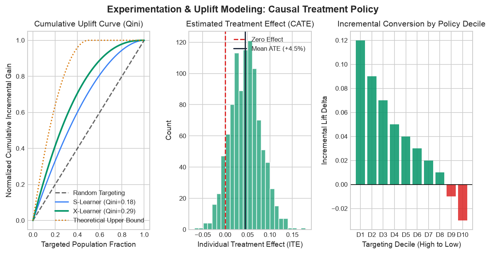

# Experimentation Uplift Modeling

> A reproducible study of randomized experiments, uplift models, and treatment policies.


This repository contains the plan for a Criteo uplift-dataset study covering power analysis, treatment-versus-control estimation, individualized targeting, and policy evaluation. The project will compare simple policies, outcome-only models, S-learners, T-learners, and a cross-fitted doubly robust approach using leakage-safe pre-treatment features.

## Table of Contents

- [Experimentation Uplift Modeling](#experimentation-uplift-modeling)
- [Quickstart / Demo](#quickstart--demo)
- [Installation](#installation)
- [Usage](#usage)
- [Development](#development)
- [Contributing](#contributing)
- [Release History](#release-history)
- [License](#license)
- [Meta](#meta)

## Quickstart / Demo
[(Back to top)](#table-of-contents)

Run power analysis, evaluate randomized experiments, and benchmark uplift learners:

```sh
uv sync
uv run uplift power --baseline-rate 0.04 --mde 0.005
uv run uplift ab-test
uv run uplift compare
uv run uplift report
```

## Installation
[(Back to top)](#table-of-contents)

Requirements:

- macOS or Linux
- Python 3.12
- [uv](https://docs.astral.sh/uv/)

```sh
git clone https://github.com/Creator101-commits/experimentation-uplift-modeling.git
cd experimentation-uplift-modeling
uv sync
```

## Usage
[(Back to top)](#table-of-contents)

The package CLI provides tools for causal inference and uplift modeling:

```sh
# Calculate required sample size and minimum detectable effects
uv run uplift power --baseline-rate 0.04 --mde 0.005 --power 0.80

# Analyze randomized trial outcome rates, confidence intervals, and covariate balance
uv run uplift ab-test --samples 5000

# Benchmark S-Learners, T-Learners, and Doubly Robust estimators
uv run uplift compare --samples 5000

# Generate full research report
uv run uplift report -o artifacts/report.md
```

Python library usage:

```python
from uplift import ABTestAnalyzer, PowerCalculator, SLearner, TLearner, DoublyRobustLearner

# Prospective power calculation
power_res = PowerCalculator.calculate_sample_size(baseline_rate=0.04, mde_absolute=0.005)

# Classical A/B test analysis
ab_res = ABTestAnalyzer.analyze(treatment=W, outcome=y)

# Fit S-Learner or Doubly Robust CATE estimator
dr = DoublyRobustLearner(known_propensity=0.85)
dr.fit(X_train, W_train, y_train)
cate_pred = dr.predict_uplift(X_test)
```

## Development
[(Back to top)](#table-of-contents)

Run the testing and linting suite:

```sh
uv run pytest
uv run ruff check .
uv run mypy src
```

## Contributing
[(Back to top)](#table-of-contents)

Contributions are welcome. To propose a change:

1. Fork it (<https://github.com/Creator101-commits/experimentation-uplift-modeling/fork>)
2. Create your feature branch (`git checkout -b feature/fooBar`)
3. Commit your changes (`git commit -am 'Add some fooBar'`)
4. Push to the branch (`git push origin feature/fooBar`)
5. Open a new Pull Request

Please make sure tests pass and the code is formatted before opening a PR.

## Release History
[(Back to top)](#table-of-contents)

* 0.2.1
    * CHANGE: Update docs (module code remains unchanged)
* 0.2.0
    * CHANGE: Remove `setDefaultXYZ()`
    * ADD: Add `init()`
* 0.1.1
    * FIX: Crash when calling `baz()` (Thanks @GenerousContributorName!)
* 0.1.0
    * The first proper release
    * CHANGE: Rename `foo()` to `bar()`
* 0.0.1
    * Work in progress

## License
[(Back to top)](#table-of-contents)

Distributed under the MIT License. See [`LICENSE`](./LICENSE) for more information.

## Meta
[(Back to top)](#table-of-contents)

Sreeharsha Kannegundla – [@YourTwitter](https://twitter.com/YourTwitter) – YourEmail@example.com

Project link: [https://github.com/Creator101-commits/experimentation-uplift-modeling](https://github.com/Creator101-commits/experimentation-uplift-modeling)
